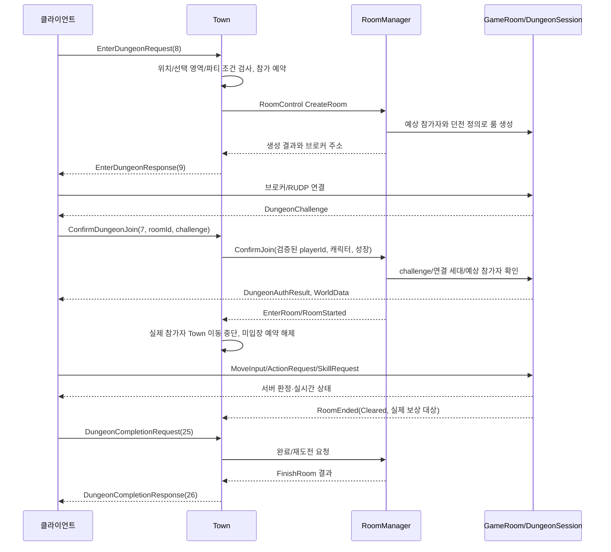

# TownServer 콘텐츠 및 패킷 개발 가이드

이 문서는 TownServer에 거래, 파티, 채팅 같은 마을 콘텐츠를 추가하고 해당 콘텐츠의
TCP 패킷을 클라이언트까지 연결하는 방법을 설명한다. 10~13절은 현재 인증·던전 입장과
런타임 구조를 설명한다. 2026-10-06 소스를 기준으로 하며 이번 문서 작업은 정적 대조만 수행했다.

## 1. 현재 책임 구분

| 구성 요소 | 책임 | 콘텐츠 코드를 둘 수 있는가 |
| --- | --- | --- |
| `TcpSession` | 4바이트 길이 프레임, 비동기 읽기·쓰기, 송신 큐 | 아니요 |
| `PlayerSession` | 패킷 파싱, 형식·접속 상태 검증, 콘텐츠 라우팅 | 최소한의 검증만 |
| `Player` | 네트워크와 무관한 플레이어 상태 | 개인 상태에 적합 |
| `TownInstance` | 플레이어·마을 공유 상태와 authoritative 처리 | 콘텐츠 진입점에 적합 |
| 별도 도메인 클래스 | 거래, 파티 등 독립 규칙과 상태 | 복잡한 콘텐츠에 권장 |
| `TownMap` | 불변 맵 데이터와 이동 판정 | 맵 관련 규칙만 |
| `DungeonCatalog` | 던전 그룹과 클라이언트 표시용 메타데이터 | 던전 목록만 |
| `Protocol` | 바이트 직렬화·역직렬화 | 콘텐츠 규칙 금지 |

`PlayerSession`이 `Player`를 상속하지 않는 현재 has-a 구조를 유지한다. 네트워크 연결의
수명과 게임 플레이어의 상태·규칙은 서로 다른 책임이다.

## 2. 콘텐츠를 추가하는 순서

거래 요청을 예로 들면 다음 순서로 진행한다.

### 2.1 규칙과 authoritative 주체 정의

코드를 작성하기 전에 아래 항목을 먼저 결정한다.

- 거래를 시작할 수 있는 플레이어 상태
- 대상 플레이어가 같은 마을에 있고 보이는 상태여야 하는지
- 동시 거래 요청과 중복 수락을 어떻게 처리할지
- 취소, 연결 종료, 시간 초과 시 상태를 어떻게 정리할지
- 아이템·재화의 최종 소유권을 어느 서버가 판정할지
- 동일 요청이 재전송되었을 때 중복 처리되지 않도록 할 방법

### 2.2 상태의 위치 결정

- 플레이어 개인 상태: `Player`에 추가한다.
- 두 명 이상이 공유하는 짧은 상태: `TownInstance`가 소유한다.
- 규칙과 상태가 커지는 콘텐츠: `TradeManager`, `PartyManager` 같은 별도 클래스를 만들고
  `TownInstance`가 has-a 관계로 소유한다.
- DB나 외부 서비스 접근: 별도 비동기 서비스에 위임한다.

빠른 초기 구현에서는 `TownInstance`에 진입점을 추가할 수 있지만, 하나의 콘텐츠가 여러
상태와 명령을 가지기 시작하면 별도 도메인 클래스로 분리한다.

### 2.3 TownInstance 진입점 추가

공개 함수는 어느 I/O 스레드에서도 호출될 수 있으므로 반드시 town strand로 전달한다.

```cpp
void TownInstance::RequestTrade(const std::uint64_t inSessionId,
    const TownProtocol::TradeRequest inRequest)
{
    const std::shared_ptr<TownInstance> self = shared_from_this();
    asio::dispatch(strand, [self, inSessionId, inRequest]()
    {
        self->RequestTradeOnStrand(inSessionId, inRequest);
    });
}
```

`RequestTradeOnStrand()`에서 수행할 작업은 다음과 같다.

1. `sessionToPlayer`로 요청자를 찾는다.
2. 요청자와 대상 플레이어가 여전히 존재하는지 확인한다.
3. 거리, 현재 거래 상태, 차단 상태 같은 콘텐츠 조건을 검증한다.
4. 서버 상태를 변경한다.
5. 관련 플레이어에게 결과 패킷을 보낸다.

`players`, `sectors`, 콘텐츠 관리자 같은 town 공유 상태는 strand 밖에서 직접 접근하면 안 된다.

### 2.4 세션에서 검증하고 라우팅

`PlayerSession::HandlePacket()`에는 다음 역할만 둔다.

- 패킷 디코딩 성공 여부 확인
- 입장 완료 여부 확인
- 문자열 길이, 수량, 열거형 범위 같은 저비용 형식 검증
- `TownInstance`의 콘텐츠 진입점 호출

대상 플레이어 존재 여부, 거래 가능 여부처럼 공유 상태가 필요한 검증은 `TownInstance`의
strand 안에서 수행한다.

### 2.5 연결 종료 처리

`TownInstance::LeaveOnStrand()`에서 해당 플레이어가 참여 중인 거래·파티·초대 상태를
정리한다. 양쪽 플레이어가 공유하는 상태라면 상대에게 취소 또는 탈퇴 결과도 전송한다.

## 3. 스레드 안전성 규칙

- `TcpSession` 송신 큐는 각 소켓 executor에서 직렬화된다.
- 마을 공유 상태는 `TownInstance::strand`에서만 읽고 수정한다.
- 콘텐츠 관리자도 `TownInstance` strand에서만 호출한다면 별도 mutex가 필요 없다.
- DB, HTTP, 파일 I/O처럼 오래 걸리는 작업을 strand에서 동기 호출하지 않는다.
- 외부 비동기 작업의 결과는 다시 `asio::dispatch(strand, ...)`로 돌아온 뒤 적용한다.
- 비동기 작업 동안 `Player&`나 컨테이너 iterator를 보관하지 않는다. 완료 시 ID로 다시 찾는다.
- 클라이언트가 보낸 플레이어 ID, 가격, 수량, 상태를 신뢰하지 않는다.

strand에서 블로킹 작업을 실행하면 모든 플레이어의 이동과 콘텐츠 처리가 함께 멈춘다.

## 4. 현재 패킷 형식

TCP 스트림은 다음 구조를 사용한다.

```text
[uint32 bodySize, big-endian][packet body]
packet body = [uint16 packetType, big-endian][payload]
```

현재 패킷 ID는 다음과 같다.

| ID | 패킷 | 방향 |
| ---: | --- | --- |
| 1 | `EnterTownRequest` | Client → Server |
| 2 | `EnterTownResponse` | Server → Client |
| 3 | `MoveInput` | Client → Server |
| 4 | `PlayerAppear` | Server → Client |
| 5 | `PlayerMove` | Server → Client |
| 6 | `PlayerDisappear` | Server → Client |
| 7 | `ConfirmDungeonJoin` | Client → Server |
| 8 | `EnterDungeonRequest` | Client → Server |
| 9 | `EnterDungeonResponse` | Server → Client |
| 10 | `MapChanged` | Server → Client |
| 11 | `DungeonSelectionOpen` | Server → Client |
| 12 | `PartyInviteRequest` | Client → Server |
| 13 | `PartyInviteAnswer` | Client → Server |
| 14 | `PartyLeaveRequest` | Client → Server |
| 15 | `PartyKickRequest` | Client → Server |
| 16 | `PartyInvitation` | Server → Client |
| 17 | `PartySnapshot` | Server → Client |
| 18 | `PartyOperationResult` | Server → Client |
| 19 | `PartySettingsRequest` | Client → Server |
| 20 | `PartyDirectoryPageRequest` | Client → Server |
| 21 | `PartyDirectoryUnsubscribe` | Client → Server |
| 22 | `PartyDirectoryPage` | Server → Client |
| 23 | `PartyDirectoryChanged` | Server → Client |
| 24 | `PartyCreateRequest` | Client → Server |
| 25 | `DungeonCompletionRequest` | Client → Server |
| 26 | `DungeonCompletionResponse` | Server → Client |
| 27 | `SkillStateRequest` | Client → Server |
| 28 | `LearnSkillRequest` | Client → Server |
| 29 | `SkillStateResponse` | Server → Client |
| 30 | `PartyDetailRequest` | Client → Server |
| 31 | `PartyDetailResponse` | Server → Client |
| 32 | `PartyJoinRequest` | Client → Server |
| 33 | `PartyJoinAnswer` | Client → Server |
| 34 | `PartyJoinRequestUpdate` | Server → Client |
| 35 | `PartyKicked` | Server → Client |
| 36 | `AdmissionTicketRequest` | Client → Server |
| 37 | `AdmissionResult` | Server → Client |

`TownMap*.json` 버전 3은 `entryPoints`와 `transitionZones`를 포함한다. `MapTransfer`는
대상 `mapId`/`entryPointId`로 이동하고, `DungeonSelection`은 `DungeonCatalog.json`의
`groupId`를 열어 준다. 영역 진입 판정과 맵 이동은 `TownInstance` strand에서 직렬화한다.

패킷 body 상한은 1MiB다. 서버 송신 대기열 상한은 4MiB이며, 상한을 초과하는 세션은
정상적인 서비스가 불가능한 상태로 취급한다.

직렬화 규칙:

- 정수는 big-endian으로 기록한다.
- `bool`은 `uint8`의 0 또는 1로 기록한다.
- `float`은 IEEE 754 비트를 `uint32`로 변환한 뒤 big-endian으로 기록한다.
- 문자열은 `[uint16 byteLength][UTF-8 bytes]` 형식이다.
- C++ 구조체 메모리를 그대로 전송하지 않는다. 패딩과 ABI가 플랫폼마다 다르다.
- 디코더는 모든 필드를 읽은 뒤 `Finished()`로 여분 바이트가 없는지 검사한다.

## 5. 새 패킷 추가 절차

현재 서버와 클라이언트는 `Protocol`을 별도로 보유한다. 두 파일의 패킷 ID, 필드 순서,
자료형은 반드시 동일해야 한다. 일치하지 않으면 해당 연결은 malformed packet으로 종료된다.

거래 요청과 결과를 추가한다고 가정한다. 아래 Trade 패킷은 미구현 예시이며 현재 마지막
ID 37 다음의 38/39를 예시로 사용한다. 실제 추가 시 YAML 정의와 양쪽 생성 헤더를 함께 맞춘다.

### 5.1 패킷 ID와 데이터 정의

기존 ID를 재사용하거나 중간 값을 바꾸지 말고 마지막 번호 뒤에 추가한다.

```cpp
enum class PacketType : std::uint16_t
{
    // 기존 값 유지
    TradeRequest = 38,
    TradeResult = 39
};

struct TradeRequest
{
    std::uint32_t requestId{};
    std::uint64_t targetPlayerId{};
};

struct TradeResult
{
    std::uint32_t requestId{};
    std::uint8_t resultCode{};
};
```

`requestId`는 클라이언트가 응답을 자신의 요청과 대응시키는 값이다. 재화 변경처럼 중복
실행이 위험한 명령에는 서버 측 중복 요청 방지도 함께 설계한다.

### 5.2 서버 Protocol 수정

`Protocol.h`에 구조체와 필요한 함수 선언을 추가한다.

```cpp
std::vector<std::uint8_t> Encode(const TradeResult& inPacket);
std::optional<TradeRequest> DecodeTradeRequest(
    const std::vector<std::uint8_t>& inPacket);
```

`Protocol.cpp`에서는 필드를 선언 순서대로 기록하고 정확히 같은 순서로 읽는다.

```cpp
std::vector<std::uint8_t> Encode(const TradeResult& inPacket)
{
    PacketWriter writer(PacketType::TradeResult);
    writer.WriteUInt32(inPacket.requestId);
    writer.WriteUInt8(inPacket.resultCode);
    return writer.Finish();
}
```

디코더는 예상 타입, 모든 필드, 값 범위, `Finished()`를 확인한다.

### 5.3 서버 수신 라우팅

`PlayerSession::HandlePacket()`의 switch에 C2S 패킷 case를 추가한다.

```cpp
case TownProtocol::PacketType::TradeRequest:
{
    const auto request = TownProtocol::DecodeTradeRequest(inPacket);
    if (!request.has_value() || !enterRequested)
    {
        tcpSession->Stop();
        return;
    }
    town->RequestTrade(GetSessionId(), *request);
    return;
}
```

패킷 형식 오류는 연결을 종료한다. 콘텐츠 조건 불충족은 연결 오류가 아니므로
`TradeResult`에 명시적인 실패 코드를 담아 응답한다.

### 5.4 클라이언트 Protocol 수정

클라이언트 `Network/TownProtocol.h/.cpp`에 서버와 동일한 enum 값과 구조체를 추가한다.

- C2S 요청: `Encode(const TradeRequest&)`
- S2C 결과: `DecodeTradeResult(...)`

서버와 클라이언트의 필드 순서가 동일한지 나란히 확인한다.

### 5.5 클라이언트 송수신 연결

`TownClient`에 `SendTradeRequest()`를 추가하고 `SendMovement()`와 동일하게 network strand에
post한 뒤 `QueuePacket()`을 호출한다.

S2C 결과는 다음 세 곳에 등록한다.

1. `TownClient::HandlePacket()` switch에서 디코딩한다.
2. `TownEvent` variant에 `TradeResult`를 추가한다.
3. `GameWorld::ProcessNetworkEvents()` 또는 별도 UI/controller가 이벤트를 처리한다.

네트워크 스레드에서 게임 오브젝트를 직접 수정하지 않는다. `TownClient`가 mutex로 보호된
이벤트 큐에 넣고 게임 스레드가 `ConsumeEvents()`로 가져가는 현재 흐름을 유지한다.

## 6. 호환성 정책

현재 프로토콜은 서버와 클라이언트를 함께 배포하는 lockstep 방식이다. 패킷 구조가 다른
구버전 클라이언트는 연결이 종료될 수 있다.

서버와 클라이언트를 독립 배포해야 한다면 콘텐츠 추가 전에 다음을 도입한다.

- 입장 요청의 `protocolVersion`
- 서버가 지원하는 최소·최대 버전
- 호환되지 않는 버전을 설명하는 입장 실패 패킷

필드를 기존 패킷 중간에 삽입하는 대신 새 패킷 ID 또는 새 버전 패킷을 추가하는 편이 안전하다.

## 7. 검증 체크리스트

아래는 기능 변경 후 사용할 검증 절차다. 이번 문서 작업에서 이 절차를 실행했다는 의미가 아니다.

### 패킷 단위 검증

- encode 후 decode한 값이 원본과 같은가
- 문자열 길이 0, 최대값, 초과값을 처리하는가
- 잘린 body와 여분 바이트를 거부하는가
- 잘못된 enum, bool, 수량, 플레이어 ID를 거부하는가
- 1MiB body 상한을 넘는 패킷을 거부하는가

### 콘텐츠 검증

- 입장 전 요청을 거부하는가
- 존재하지 않거나 퇴장한 플레이어를 안전하게 처리하는가
- 같은 요청이 동시에 들어와도 상태가 한 번만 변경되는가
- 요청 도중 연결이 끊어지면 공유 상태가 정리되는가
- 실패가 세션 종료가 아닌 명시적 결과 패킷으로 전달되는가
- DB 응답이 늦어져도 이동 tick이 멈추지 않는가

### 통합 검증

1. 서버와 클라이언트 Debug/Release를 빌드한다.
2. 클라이언트 두 개 이상을 연결한다.
3. 정상 요청과 거절 요청을 각각 보낸다.
4. 요청 중 한 클라이언트를 종료한다.
5. 재접속 후 이전 임시 상태가 남지 않았는지 확인한다.

## 8. 관련 파일

- `Protocol.h/.cpp`: 서버 패킷 정의와 직렬화
- `PlayerSession.h/.cpp`: C2S 검증과 라우팅
- `TownInstance.h/.cpp`: authoritative 콘텐츠 처리와 공유 상태
- `TownMap.h/.cpp`: 맵 데이터, 이동 판정, 진입 영역 검색
- `DungeonCatalog.h/.cpp`: 던전 그룹과 선택창 메타데이터
- `Data/TownMap*.json`: 맵·도착 지점·전환 영역
- `Data/DungeonCatalog.json`: 던전 그룹과 표시 정보
- `Player.h/.cpp`: 네트워크 비종속 플레이어 상태
- `../Shared/TcpSession.h/.cpp`: TCP framing·TLS·비동기 송수신
- `../Shared/NetworkConstants.h`: body 및 송신 큐 상한
- `NetworkConstants.h`: 타운 기본 포트·I/O 스레드 수

## 9. ODBC 저장 프로시저 실행

`../Shared/Database/OdbcDatabase`는 각 서버 프로세스 안에서 DB 전용 작업 큐와 커넥션 풀을 운영한다.
`TownInstance::RunStoreProcedure()`로 실행하면 완료 콜백이 town strand에서 호출된다.
DB worker의 입력 바인딩·결과 매핑에서는 마을 상태를 접근하지 않는다.

### 연결과 실행 범위

- Town 프로세스 환경 변수 `ACTIONRPG_TOWN_DB_CONNECTION_STRING`으로 ODBC 연결 문자열을 전달한다.
  비밀정보를 소스·설정 사본·로그·명령 인자에 남기지 않는다. 실행 환경에 대상 DB용
  ODBC 드라이버가 필요하며 드라이버와 서버 프로그램의 32/64비트 구성이 일치해야 한다.
- Town은 서비스별 `ACTIONRPG_TOWN_DB_CONNECTION_STRING`을 요구한다. 로컬 런처는 명시 설정이 없으면
  기존 보호 DB 연결을 재사용한다. 실운영에서는 Auth와 분리한 최소 권한 계정을 권장한다.
  V5 스키마/이력/프로시저 원문 검증에 실패하면 입장을 열지 않는다. 공개 캐릭터 프로시저 5개와
  `get_inventory_schema_migration_history` EXECUTE만 부여하며 Google 로그인·내부 helper 직접 실행 권한은 제외한다.
- 연결은 첫 요청에서 생성하고 worker별로 유지한다. 기본 연결 수 2, 대기 요청 상한 128,
  큐 대기 제한 30초, 연결 제한 5초, statement 제한 10초다. 값은 `DatabaseOptions`에서 지정한다.
- 연결 실패나 실행·매핑 오류 후 해당 연결을 폐기한다. 다음 새 요청에서 다시 연결하며,
  실패한 요청 자체를 자동 재실행하지 않는다. 경고·잘림·타임아웃 옵션 대체도 오류로 취급한다.
- 연결·query 타임아웃을 설정하고 확인할 수 있는 드라이버가 필요하다. 타임아웃의 실제
  적용 범위는 드라이버별로 검증해야 한다. 이 설정은 전체 작업의 강제 종료 시각을 보장하지 않는다.
- `Stop()`은 새 요청을 거절하고 접수된 요청을 처리한다. 큐에서 만료된 요청은 실행하지 않는다.
  소멸자는 worker 종료를 기다리므로 town strand에서 서비스 소멸자를 실행하지 않는다.
  완료 executor의 work guard는 접수·거절된 요청의 콜백 전달까지 I/O context가 종료되는 것을 막는다.

### Req/Res와 사용 예시

실행 클래스는 `IStoreProcedure<Req, Res>`를 상속하고 아래 세 함수를 정의한다.

| 함수 | 역할 |
|---|---|
| `GetName()` | 고정된 프로시저 이름 반환. 영문·숫자·밑줄과 점으로 구분한 한정 이름만 허용 |
| `BindParameters()` | 프로시저 선언 순서대로 IN/OUT/INOUT 값 등록 |
| `ReadRow()` | 각 결과 행을 Res로 매핑. 결과 인덱스는 컬럼이 있는 결과 집합 기준 0부터 시작 |
| `ValidateResults()` | 선택적 재정의. 빈 결과셋까지 포함한 결과셋·전체 행 개수와 Res를 커밋 전에 검사 |

입력값은 `AddInput()`으로 등록한다. OUT/INOUT은 Res의 `std::optional<T>` 멤버를
`AddOutput()`/`AddInputOutput()`에 등록한다. INOUT 초기값이 Req에 있으면 먼저 Res에 복사한다.
OUT/INOUT의 대상 멤버는 결과 매핑 중에도 같은 위치에 유지한다. 매핑하면서 재할당할
컨테이너 요소를 출력 파라미터 대상으로 등록하지 않는다.
지원 타입은 `int32_t`, `uint32_t`, `int64_t`, `uint64_t`, `double`, `bool`, `wstring`과 그 optional이다.
문자열은 ODBC Unicode API를 사용한다. 바이너리·날짜·정밀 소수 등은 실제 필요 시 별도 계약을 추가한다.

다음은 **사용 형태를 설명하는 예시**다. `EchoProcedure`나 DB 프로시저를 자동 생성·등록·실행하지 않는다.
이름과 파라미터·결과 형태가 일치하는 실제 저장 프로시저가 먼저 있어야 한다.

```cpp
namespace Db = ActionRPG::Database;

struct EchoReq
{
    std::int32_t value{};
    std::wstring text;
};

struct EchoRow
{
    std::optional<std::int32_t> value;
    std::optional<std::wstring> text;
};

struct EchoRes
{
    std::vector<EchoRow> rows;
};

class EchoProcedure final : public Db::IStoreProcedure<EchoReq, EchoRes>
{
public:
    std::wstring_view GetName() const noexcept override { return L"EchoProcedure"; }

    void BindParameters(Db::ProcedureParameters& inParameters, EchoRes&) const override
    {
        inParameters.AddInput(req.value);
        inParameters.AddInput(req.text);
    }

    void ReadRow(Db::ProcedureRow& inRow, std::size_t inResultIndex, EchoRes& outResponse) const override
    {
        if (inResultIndex != 0 || inRow.GetColumnCount() != 2)
            throw Db::DatabaseException({ Db::DatabaseErrorCode::InvalidResult, "Unexpected echo result." });
        outResponse.rows.push_back({ inRow.Read<std::int32_t>(1), inRow.Read<std::wstring>(2) });
    }
};

// townInstance is the existing shared_ptr<TownInstance>.
auto procedure = std::make_unique<EchoProcedure>();
procedure->req.value = 123;
procedure->req.text = L"hello";
townInstance->RunStoreProcedure(std::move(procedure),
    [](TownServer::Domain::TownInstance& inTown, Db::ProcedureResult<EchoRes> inResult)
    {
        if (!inResult.IsSuccess())
        {
            // Inspect inResult.error. An uncertain execution must not be retried blindly.
            return;
        }
        // Use inResult.response->rows on the town strand.
        // Re-find the target by persistent ID/session ID and validate its current state before applying.
    });
```

`Run()`에 `unique_ptr`를 넘긴 뒤에는 객체나 멤버의 별도 포인터로 수정하지 않는다.
콜백은 예외를 던지지 않아야 하며, 호출자 executor/context는 완료까지 살아 있어야 한다.
town 객체가 이미 소멸했다면 `RunStoreProcedure()`는 게임 상태 콜백을 호출하지 않는다.
여러 요청은 worker 간에 실행 순서가 바뀔 수 있다. 같은 캐릭터의 연속 변경은 콘텐츠에서
이전 결과를 기다리거나 DB의 조건부 갱신·버전·제약으로 충돌을 검증한다.

### 트랜잭션·결과·마이그레이션

- 한 객체의 CALL 전체를 같은 연결·트랜잭션에서 처리한다. 모든 결과와 OUT 값의 처리가 끝나고
  커밋이 확인된 후 성공 Res를 반환한다. 출력 파라미터만 반환하는 프로시저도 지원한다.
  `IsSuccess()`는 호출·결과 처리·커밋의 성공을 뜻한다. 게임 규칙의 승인 여부나 필수 결과 행의
  존재 여부는 해당 프로시저의 Res를 통해 콘텐츠에서 확인한다.
- 프로시저는 내부 COMMIT/전체 ROLLBACK·DDL·세션 설정 변경을 하지 않는 계약을 따른다.
  합의된 savepoint 부분 롤백은 외부 트랜잭션을 종료하지 않는 범위에서만 사용한다.
  ODBC는 DBMS별 트랜잭션 의미를 통일하지 않는다. 대상 DBMS의 트랜잭션 지원, 테이블 엔진,
  프로시저 구현과 드라이버를 확인해야 한다. 트랜잭션 밖 외부 효과는 자동 복구되지 않는다.
- 결과 컬럼은 1부터 증가하는 순서로 한 번씩 읽는다. NULL은 optional로 구분하고,
  컬럼 타입 불일치·값 범위 초과·잘린 문자열을 성공으로 처리하지 않는다.
- 문자열당 32768 UTF-16 코드 단위, 전체 행 4096, 결과 집합 16, 읽은 결과 값 4MiB를 제한한다.
  큰 목록은 프로시저의 페이지 단위 조회로 처리한다.
- 오류는 고정된 문맥, SQLSTATE, native code, `executionMayHaveOccurred`로 전달한다.
  driver 원문 오류 메시지는 접속 정보나 SQL 값을 포함할 수 있어 전달·출력하지 않는다.
- ODBC 모듈 자체는 스키마/프로시저를 생성하거나 적용하지 않는다. Google 로그인의
  대상 DBMS·논리 계약·SQL 파일은 아래 10절을 따른다. 수동 Up/Down 도구와 Auth의
  기동 적용 이력·실제 스키마 검증은 구현되어 있다. 실제 DB 적용·운영 검증은 별도 절차다.
- 프로시저·스키마 변경은 [공통 DB 규칙](../../docs/workflows/DATABASE_MIGRATIONS.md)을 따라
  반드시 버전 파일로 관리한다.
  적용된 파일은 불변이며, 마을 서버가 기동하면서 마이그레이션을 자동 적용하지 않는다.

## 10. AuthServer 분리와 타운 입장

Google ID 토큰 검증과 `login_google_account` 계정 조회는 별도 AuthServer가 담당한다.
[Auth API 및 실행 계약](../AuthServer/DEVELOPMENT.md)을 따른다. TownServer의 공통 ODBC
실행기는 유지하지만 로그인 계정 프로시저와 Google 인증 증명을 소유하지 않는다.

타운 클라이언트 TCP는 TLS 1.2 이상이 필수다. `ACTIONRPG_TOWN_TLS_CERT`,
`ACTIONRPG_TOWN_TLS_KEY`, `ACTIONRPG_AUTH_HOST`, `ACTIONRPG_AUTH_CA_FILE`,
`ACTIONRPG_TOWN_ID`, `ACTIONRPG_TOWN_AUTH_KEY`가 필요하다. TLS 설정이 없으면
시작에 실패하며, 평문 입장이나 게스트 입장으로 우회하지 않는다.

클라이언트는 Auth HTTPS에서 목적 타운 ID가 지정된 30초 단일 사용 티켓을 받은 뒤,
TLS 타운 연결의 첫 패킷으로 `AdmissionTicketRequest(36)`을 전송한다.
타운은 Auth 내부 HTTPS `/internal/consume` 승인으로만 계정 ID를 설정하고
`AdmissionResult(37, result=0)`을 응답한다. 이후 캐릭터 목록/생성/선택(38~43)을 진행한다.
DB 소유 캐릭터 복원에 성공하면 선택 응답(43), 기존 입장 응답(2), 스킬·인벤토리 상태를 차례로 보낸다.
이전 `EnterTownRequest(1)`의 이름·종류 직접 지정 입장은 거절한다.
계정 ID나 Google ID 토큰을 타운 패킷으로 제출하지 않는다.
기존 패킷 ID 1~35는 유지하며 새 패킷은 YAML 마지막에 추가했다. 클라이언트의 헤더·
로그인/TLS 연결은 별도 클라이언트 담당 소스에 구현 경로가 있다. 실제 설정과 사용 절차는
[클라이언트 문서](../../../ActionRPGClient/ActionRPGClient/README.md)를 따른다.
현재 소스의 존재를 실제 인증 왕복 검증 완료로 간주하지 않는다.

36의 payload는 64자리 소문자 hex ticket 문자열이며 body는 타입 2바이트 + 문자열 길이
2바이트 + 값 64바이트로 총 68바이트다. 37은 타입 2바이트 + result 1바이트로 총 3바이트다.
둘 다 앞에 별도 uint32 body 길이가 붙는다. 서버는 성공 result=0만 보내며 대기/종료 사유는
추가 SessionStatus(52)로 알린다. 이유 없이 종료된 연결의 원인은 클라이언트가 임의로 추정하지 않는다.

Auth HTTP 작업은 제한된 별도 worker에서 처리하며 town strand를 막지 않는다.
15초 권한을 1초 주기로 갱신하고 권한 만료/갱신 실패/새 로그인/타운 이동 시 연결을 종료한다.
늦은 응답은 요청 시작 시각과 세션 시도 ID로 검사한다. 타운 계정 ID 조회는 로컬 만료를
확인하므로 완료 콜백 대기로 권한을 연장하지 않는다.

연결 종료 시 타운 객체를 제거한다. 던전 참여 또는 입장 예약이 있었다면 RoomServer의
멤버 제거/부재 확인 응답 이후 Auth 소유권을 해제한다. RoomControl 연결 단절을 퇴장
확인으로 간주하지 않는다. 퇴장 확인 또는 Auth 해제 응답을 잃으면 새 타운 입장을 차단한다.
룸 퇴장 확인과 Auth 해제의 자동 복구는 구현하지 않았다. 캐릭터 DB 소유권 해제는 실패 시
실행 중인 Town에서 5초 간격으로 재시도하며, 완료 전에는 Auth 소유권을 유지한다.
캐릭터 성장·인벤토리·장비는 저장 후 새 타운에서 복원한다. 관련 운영 제한은 Auth 문서를 따른다.

Auth 기동 시 실제 DB 적용 이력·체크섬·구조 검증에 실패하면 로그인/입장을 503으로 차단한다.
[DB 마이그레이션 규칙](../../docs/workflows/DATABASE_MIGRATIONS.md)의 수동 Up/Down을
사용하며 관련 서비스 종료 → Up → 동일 SQL 배포 → Auth 검증 기동 → 타운/룸 기동 순서를 따른다.
이번 문서 작업에서 빌드, 테스트, 서버 실행, 패키지 설치, 실제 DB/Google 요청은 수행하지 않았다.

## 11. 기동·인증된 플레이어의 수명

`main.cpp`는 인자와 환경을 검사하고 실행 파일 기준 Data의 맵·던전 목록·성장/스킬 정의를
읽는다. 하나의 io_context에 TownInstance, 클라이언트 TLS acceptor, loopback RoomControl
acceptor를 연결하고 지정한 I/O 스레드가 실행한다. 공유 상태의 권위는 TownInstance strand다.

| 단계 | 현재 실행 경로 | 거절/종료 조건 |
|---|---|---|
| TCP/TLS 연결 | TownClientTcpServer → Shared/TcpSession | TLS 설정/handshake 실패, 10초 handshake 제한 |
| 인증 전 | PlayerSession::HandlePacket → AdmissionTicketRequest | 인증 전 다른 게임 패킷, malformed, 중복 인증 시도 |
| Auth 소비 중 | TownInstance::Admit → AuthControlClient | 10초 admission 제한, 과다 대기, Auth 거절/timeout |
| 인증 완료 | 계정 ID·lease/local deadline 설정, 패킷 37 | 지연 결과의 이전 시도/종료 세션은 적용하지 않음 |
| 마을 입장 | CharacterSelectRequest → DB claim → EnterOnStrand | 미인증, 소유권/generation 충돌, DB 복원 실패 |
| 게임 중 | 마을 이동·파티·스킬·던전 요청 | 계정 local deadline 만료 시 이후 게임 요청 차단 |
| 연결 종료 | Disconnect → CloseAuth → TownInstance::Leave | 던전/예약 정리 확인 후 Auth release |

PlayerSession은 Unauthenticated → ResolvingAccount → Authenticated → Closed 상태를
갖는다. ResolvingAccount는 현재 Auth HTTPS 승인을 기다리는 상태 이름이며 Town이 Google
로그인 프로시저를 직접 실행한다는 뜻이 아니다. 계정 ID는 클라이언트 EnterTown 입력이 아니라
Auth consume 응답에서만 설정한다.

선택 성공 시 Town의 nextPlayerId로 런타임 ID를 발급하고 기본 맵 spawn에 배치한다.
이름·종류·성장·가방·장비는 인증 계정의 DB 캐릭터에서 복원하며 실패를 기본 상태로 대체하지 않는다.
영속 characterId와 기존 패킷의 종류 characterId/runtime playerId는 구분한다.

### Auth 대기와 만료

AuthControlClient의 별도 worker 2개와 pending 상한 64개가 HTTPS를 수행하고, 완료를
호출자 executor로 post한다. work guard가 완료 전달까지 io_context 수명을 유지한다.
인증서 CA/호스트명을 검증하며 리다이렉트를 허용하지 않는다. 연결/읽기/쓰기 timeout은
각각 3초다. 결과가 불명확한 consume/renew/release를 자동 재전송하지 않는다.

Town의 admission 레코드는 활성 연결을 포함해 최대 10000개이고 1초 주기로 만료/갱신을 확인한다.
15초 lease의 local deadline은 요청 시작 시각을 기준으로 설정하며 응답이 늦게 왔다고
응답 수신 시각부터 새 15초를 더하지 않는다. 세션 시도 ID, 연결 상태, 현재 admission 상태를
함께 확인한다. 갱신은 1초 주기이며 실패/만료 시 TLS 연결을 종료한다. 새 로그인 통보 push는 없다.

### 중복 접속 대기와 종료 사유

원본 `Tool/TownPacketDefine.yml`의 마지막에 ID 52 `SessionStatus`를 추가하며 기존 ID 1~51은 유지한다.
필드는 `code uint8`, `retryAfterMs uint32`이고 Town의 big endian 타입 uint16까지 body 7바이트다.
외부 body 길이 uint32 프레임과 성공 AdmissionResult(37, result=0)는 변경하지 않는다.

| code | 의미 | retryAfterMs |
|---|---|---|
| 1 | WaitingForPriorOwner: 기존 접속 정리 중 | 1000 |
| 2 | Replaced: 다른 접속으로 교체 | 0 |
| 3 | AdmissionTimeout: 입장 대기 시간 초과 | 0 |
| 4 | AuthUnavailable: 인증 확인 불가/거절 사유 불명 | 0 |
| 5 | AuthorizationExpired: 접속 권한 만료 | 0 |
| 6 | LoggedOut: 로그아웃 | 0 |
| 7 | ServerTransfer: 다른 타운으로 이동 | 0 |
| 8 | AccountUnavailable: 계정 사용 불가 | 0 |

명시적인 Auth Pending은 lease grant가 아니며 같은 티켓을 서버만 1초 이상 간격으로 재확인한다.
최초 연결의 30초 상한과 티켓 잔여 시간을 적용하고 반복 응답으로 연장하지 않는다. 최초 Pending만 code=1을 보내며
클라이언트는 같은 연결에서 대기 표시 후 성공 37을 기다린다. 인증 전 캐릭터/게임 패킷이나 티켓 재전송은 금지한다.
최신 요청만 유효하며 다른 접속이 티켓을 대체하면 대기 중인 이전 요청도 종료된다. 오류/응답 유실은 자동 재시도하지 않는다.
종료 code=2~8은 인증을 즉시 폐기하고 패킷 전송을 시도한 뒤 최대 1초 내 닫는다. 그동안 입력을 무시하고 unsent
게임 큐를 버리되 이미 진행 중인 write buffer는 완료/취소까지 유지한다. 알림 전달을 보장하지는 않는다.
클라이언트는 종료 이유를 표시하고 무한 로그인·새 티켓 발급을 하지 않는다. 구형 클라이언트의 ID52 처리는 보장하지
않으므로 서버/클라이언트를 함께 배포한다. DB·던전 확인 전 소유권 강제 해제나 신규 입장 허용은 하지 않는다.

### 종료와 소유권 해제

클라이언트 TCP 종료만으로 Room의 플레이어가 제거되었다고 판단하지 않는다. 타운에 던전
참여/예약이 있으면 RoomControl LeaveRoom을 요청하고 멤버 제거 또는 부재 확인을 기다린다.
확인 후 진행 중 DB 작업과 캐릭터 소유권 해제를 마치고 해당 lease/connection을 Auth release에 제출한다.
DB release의 일시 실패는 기존 admission 타이머에서 5초 간격으로 재시도한다. 저장 명령은 자동 재실행하지 않는다.
응답이 없거나 RoomControl이
끊기면 소유권을 자동 해제하지 않는다. RoomControl 장애 시 관련 세션을 종료하면서 기존
룸 관계를 보존하여 종료 확인을 우회하지 않는다. 자동 복구/재연결은 구현하지 않았다.

## 12. 던전 생성·입장·전투·복귀



생성 전 Town은 요청한 zoneId가 플레이어의 실제 위치에서 열리는 DungeonSelection 영역인지,
그 그룹에서 dungeonId를 선택할 수 있는지 검사한다. 이미 룸에 있거나 예약 중이면 거절한다.
파티는 리더와 진행 중 요청/참가자 상태를 검증한다. 클라이언트가 보고한 UID·위치로 참가를 승인하지 않는다.

RoomControl은 등록된 룸 서버의 용량과 현재 룸 수를 보고 가능한 서버를 선택한다. 생성 응답은
requestId와 해당 룸 서버를 대조한다. 룸 ID는 상위 32비트의 roomServerId와 하위 생성 번호로
구성된다. 현재 단일 타운 안의 등록/예약 관리이며 전역 분산 룸 디렉터리가 아니다.

ConfirmDungeonJoin은 현재 세션의 playerId와 예약 roomId를 대조한다. 캐릭터/성장 상태도
서버 보유 값을 Room에 전달한다. RoomManager는 challenge로 대기 DungeonSession을 찾고
연결 세대와 예상 참가 여부를 검사한다. 다른 연결의 늦은 확인으로 새 연결을 인증하지 않는다.
GameRoomServer가 Google ID 토큰이나 Auth gameToken을 다시 검증하는 흐름은 없다.

GameRoom 상태는 WaitingForPlayers → Running → Cleared/Stopped다. 참가자가 모두 들어오면
시작하며, 30초 입장 제한 시점에는 실제 입장자를 기준으로 시작한다. 아무도 없으면 중단한다.
월드 초기 데이터 전송이 완료되기 전에는 게임 요청/실시간 상태를 허용하지 않는다.

Room의 몬스터는 생성 때 한 번 배치한다. 현재 방에 살아 있는 몬스터가 없으면 게이트 이동을
허용하고, 같은 룸에서 처치한 몬스터는 재방문해도 부활하지 않는다. 보스 처치 클리어 순간의
잔류 플레이어가 보상 대상이며 현재는 대상 전달/로그까지다. 인벤토리 영속 저장은 지원하지만
던전 보상 지급과 아이템 드랍은 연결하지 않았다.
재도전은 새 룸 생성 성공 후 이전 룸을 정리하며 새 몬스터 상태로 시작한다.

정상 복귀/재도전은 실제 참가자 집합과 완료 상태를 검증한다. 클리어 뒤 바로 타운 상태로
전환하는 대신 완료 요청/응답 흐름을 사용한다. 상세 전투 메시지·스킬 판정은
[전투 계약](../GameRoomServer/COMBAT_PROTOCOL.md), [스킬 계약](../GameRoomServer/PLAYER_SKILLS.md)을 따른다.

## 13. 실행 경계·스레드·확장 위치

| 상태/작업 | 실행 경계 | 주의할 점 |
|---|---|---|
| acceptor·서버 세션 목록 | Shared/TcpAcceptServer strand | 닫힘 콜백으로 서버의 세션 제거 |
| 세션 프레이밍·송신 큐 | 연결별 socket executor/strand | async_write 버퍼 수명·송신 순서 유지 |
| 마을 플레이어·파티·예약·스킬 | TownInstance strand | 별도 worker에서 컨테이너/Player를 직접 접근하지 않음 |
| Auth HTTPS | AuthControlClient worker → Town strand | 완료 시 시도/현재 상태/deadline 재검사 |
| ODBC | DB worker → 요청한 executor | 결과 커밋 후 현재 플레이어를 ID로 다시 조회 |
| 룸 목록·challenge 대기 | RoomManager strand | Room 연결의 generation 대조 |
| 룸 이동·AI·전투 | 각 GameRoom strand | 룸 안 상태를 전투 tick과 함께 직렬화 |
| RUDP callbacks·연결/스트림 바인딩 | DungeonSession 동기화 → 룸/관리자 post | 바인딩 mutex와 세대/weak stream lease 유지 |

Town은 50ms tick(20Hz)과 매 2tick 상태 전송(10Hz)을 사용한다. 실제 경과 시간은 최대
0.25초로 제한하며 500ms 동안 새 이동 입력이 없으면 멈춘다. 룸 참가자는 Town 이동 계산에서
제외된다. Room은 1/30초 고정 전투 tick과 15Hz 실시간 전송을 사용하며, 늦은 tick을 무제한
따라잡지 않는다. Room 이동 입력 제한은 1초다. 이는 서로 다른 서버의 규칙이다.

TCP body 1MiB와 송신 대기 4MiB 상한은 Shared/NetworkConstants에 있다. Room 월드는
총 4MiB 이내 분할 전송이며 실시간 프레임/대역폭 한도는 별도 전투 계약을 따른다.
I/O 스레드 수를 늘려도 하나의 TownInstance나 GameRoom 공유 상태를 동시에 수정하지 않는다.
strand의 동기 DB/HTTPS 호출이나 큰 파일 처리로 서버 업데이트를 막지 않도록 변경한다.

| 파일 | 런타임 책임 / 수정 위치 |
|---|---|
| [main.cpp](main.cpp) | CLI, 실행 파일 기준 데이터 로딩, I/O 스레드와 서버 수명 |
| [TownClientTcpServer.cpp](TownClientTcpServer.cpp) | TLS 수신과 PlayerSession 생성/닫힘 |
| [PlayerSession.cpp](PlayerSession.cpp) | 인증 전 게이트, C2S 형식·상태 검증 |
| [TownAuthentication.cpp](TownAuthentication.cpp) | consume/renew/release, 시도와 local deadline |
| [AuthControlClient.h](Authentication/AuthControlClient.h) | Auth HTTPS worker/한도/완료 executor |
| [TownInstance.cpp](TownInstance.cpp) | 입장·이동·가시성·파티·예약·복귀·성장 상태 |
| [RoomControlTcpServer.cpp](RoomControlTcpServer.cpp) | 룸 등록·선택·생성/퇴장 확인과 응답 대응 |
| [TcpSession.cpp](../Shared/TcpSession.cpp) | 공통 framing/TLS/비동기 송신 수명 |
| [TownPacketDefine.yml](../../Tool/TownPacketDefine.yml) | 패킷 ID·필드의 정의 원본 |
| [RoomControlProtocol.h](../Shared/RoomControlProtocol.h) | Town↔Room 내부 메시지 계약 |
| [RoomManager.cpp](../GameRoomServer/RoomManager.cpp) | 룸 생성·입장 인증·종료 관리 |
| [GameRoom.cpp](../GameRoomServer/GameRoom.cpp) | tick·몬스터·전투·완료 판정 |
| [DungeonSession.cpp](../GameRoomServer/DungeonSession.cpp) | RUDP 연결 challenge, 월드/실시간 전송 |

설정·서비스 시작 순서는 [저장소 README](../../README.md)를 따른다. 원격 RoomControl과 제어 연결
장애 자동 복구는 별도 설계 대상이다. V5 캐릭터·인벤토리 연동은 정적으로 검토했으며 빌드·실행 검증은 하지 않았다.

## 14. 영속 캐릭터·인벤토리 계약

`TownCharacters.cpp`는 목록/생성/선택/해제를, `TownInventory.cpp`는 저장 확정과 인벤토리 요청을 담당한다.
규칙은 `Shared/Inventory.h`, DB의 5개 공개 프로시저 래퍼는 `Database/CharacterStoreProcedure.h`에 있다.
DB worker가 CALL 전체 결과를 검증하고 커밋한 뒤 town strand가 세션·계정·소유 토큰·generation을 다시 확인한다.
캐릭터별 저장을 직렬화하며 DB 오류/불명확한 commit을 성공으로 보고하거나 초기 상태로 대체하지 않는다.

### 아이템 데이터와 슬롯

`Data/Items.json`은 `format=Items`, `schemaVersion=1`, `items` 배열이다. 초기 배열은 비어 있으며
임의 보상/드랍/테스트 아이템을 지급하지 않는다. 각 정의의 필수 필드는
`id/name/description/icon/category/maxStack`이다. ID는 영문으로 시작하는 1~64바이트의
영문·숫자·밑줄·점·하이픈이고 icon은 `Images/` 아래 PNG 상대 경로다.
장비는 추가로 `equipmentSlot/requiredLevel/characterDefinitionIds/stats/effects`를 가진다.
비어 있는 characterDefinitionIds는 모든 종류를 허용한다. stats는 숫자 객체, effects는 배열이며 실행하지 않는다.

| container | 의미 | slot |
|---|---|---|
| 0 | Equipment, 비스택 | 0~39 |
| 1 | Material | 0~39 |
| 2 | Consumable | 0~39 |
| 3 | Quest | 0~39 |
| 4 | 장착 | 0 Weapon, 1 Top, 2 Bottom, 3 Shoes, 4 Ring, 5 Necklace, 6 Bracelet |

인벤토리 JSON은 `{"items":[{"instanceId":"32자리 소문자 hex","definitionId":"item ID","count":1,"container":0,"slot":0}]}`다.
ID는 CSPRNG 128비트이며 장착/해제에도 유지한다. 장비 maxStack은 1, 나머지는 정의 값을 따른다.
최대 167행·정의 ID 64바이트·uint32 최대 수량을 넣은 JSON의 계산상 상한은 29,236바이트다.
저장 JSON은 32KB 이내로 검증하며 ODBC 문자열·전역 TCP 버퍼 한도는 확대하지 않는다.

획득은 기존 스택의 여유를 슬롯 순서로 채우고 빈칸에 나눈다. 전량을 넣을 수 없으면 아무것도 바꾸지 않는다.
자동 소비는 수량 오름차순, 동률이면 instanceId 오름차순이다. 지정 차감은 해당 스택에서만 수행한다.
장착 조건을 통과한 교체는 새 장비의 원래 칸으로 이전 장비를 반환하며 해제에는 빈 장비칸이 필요하다.
던전에서도 장착/교체/해제를 허용한다. Use는 아래 V6 사용 계약으로 처리하며 Sell은 NotImplemented로 거절한다.
Discard는 지정 수량을 영구 삭제하며 월드 드랍을 만들지 않는다. 클라이언트는 삭제 확인창을 제공해야 한다.

### 패킷과 크기

기존 ID 1~37을 유지하고 다음 ID에 `std::string json` 필드 하나를 사용한다.

| ID | 패킷 |
|---|---|
| 38/39 | CharacterListRequest/Response |
| 40/41 | CharacterCreateRequest/Response |
| 42/43 | CharacterSelectRequest/Response |
| 44/45 | InventoryStateRequest/Response |
| 46/47 | InventoryOperationRequest/Response |
| 48 | ItemDefinitionsResponse |

requestId는 CSPRNG 256비트의 64자리 소문자 hex다. 64비트 characterId/revision/ownerGeneration은
10진 문자열로 표현하고 종류 ID·수량·슬롯·배치 번호는 JSON 정수로 보낸다. 요청 본문은 4KB,
응답은 60KB 이내다. 선택 성공 뒤 43 → 2 → 스킬 상태 → 인벤토리 상태·정의 배치 순서로 전송한다.

- 목록/인벤토리 조회: `{requestId}`. 목록의 characters 행은
  `characterId/name/characterDefinitionId/level/ownerGeneration/revision`이며 64행 단위 batchIndex/batchCount를 포함한다.
- 생성: `{requestId,name,characterDefinitionId}`. 기본 레벨/SP는 서버 정책에서 결정한다.
- 선택: `{requestId,characterId,expectedOwnerGeneration}`. 목록의 generation으로 CAS claim한다.
- 변경: `{requestId,revision,action,instanceId,count}`. action은 Equip/Unequip/Discard/Use/Sell이며 장착/해제 count는 1이다.
- 결과 공통: `{requestId,result,characterId,revision}`. 성공 문자열은 Succeeded이며 변경 성공에는 inventory가 포함된다.
  DB 오류는 AccountUnavailable/CharacterNotFound/RevisionConflict/NameTaken/StaleOwner/RequestConflict다.

상태(45)는 inventory와 definitionBatchCount를 보낸다. 그 상태가 참조한 정의만 48의 definitions 배열로 전송한다.
정의 한 건은 8KB, 배치는 16KB 이내다. `(requestId,characterId,revision)`을 공통 키로 하고
batchIndex/batchCount로 완료를 판정한다. 최대 167종의 정의 전송은 약 1.4MB 이내이며 기존 4MB 송신 큐를 따른다.
마스터 파일 상한은 4MB다. 클라이언트는 모든 배치 수신 전 정의를 로딩 중으로 두고 미수신 정의를 삭제로 취급하지 않는다.
오래된 snapshot key의 배치는 현재 상태에 합치지 않는다.

### 저장·재접속·룸 연동

save에는 원본 명령을 정규화한 operationJson(2KB 이내), 원래 expectedRevision, 제안 성장/인벤토리를 전달한다.
DB는 account/character/ownerToken/generation을 잠근 뒤 영속 요청 ID·명령 해시를 먼저 확인한다.
중복 성공은 재수정 없이 최신 상태를 반환한다. 오래된 revision 요청은 도메인 재계산 전에 이 경로로 보내므로
이미 장착된 아이템의 재전송도 기존 성공을 확인할 수 있다. 새 충돌 요청은 저장하지 않는다.
타임아웃 시 클라이언트 자동 재전송 대신 상태를 조회한다. DB 저장 결과가 불명확하면 서버는 세션을 종료한다.

`AcquireItem/ConsumeItem`은 서버 콘텐츠 전용 API다. 호출자는 64자리 requestId와 원래 expectedRevision을 유지해야 한다.
클라이언트용 획득/자동 소비 패킷, 몬스터 보상·드랍, 상점·장비 능력치 적용은 이번 범위에 없다.
레벨/SP/습득 스킬도 같은 저장 트랜잭션으로 확정한다.

Town→Room의 ConfirmJoin/UpdatePlayerProgress는 기존 progression 문자열에
`{characterId,revision,ownerGeneration,progression,equipment}` 문서를 전달한다. equipment는 장착된 items 행만 담는다.
룸은 다른 영속 캐릭터 또는 이전/equal revision 갱신을 무시하며 DB 자격 증명을 가지지 않는다.
월드 JSON에 persistentCharacterId/inventoryRevision/equipment를 덧붙이고 realtime 바이너리 레이아웃은 유지한다.
신규 Town/Room과 패킷 38~48을 사용하는 클라이언트를 함께 배포해야 한다.

### V6 아이템 사용: HP 회복과 직선 투척

`ItemUseService`는 Town strand에서 보유 스택·revision·레벨·요청 ID와 DB 확정을 조정한다.
룸 strand의 `ItemUseAction::Validate/DoAction`, `RecoveryItemAction`, `ThrowItemAction`이 전투 상태를 검사하고 효과를 적용한다.
Town 또는 DB 작업이 진행되는 동안 룸 전투를 중단하거나 네트워크 왕복을 DB 트랜잭션 안에서 기다리지 않는다.

| 정의 | 효과 | 레벨 | 같은 정의의 쿨타임 |
|---|---|---|---|
| UnripeStrawberry | HP 30 회복, 최대 HP까지 제한 | 1 | 5초 |
| Stone | 직선 투사체 1개, 피해 10, 속도 600, 거리 480, 반경 6 | 1 | 1초 |

던전 Running 상태에서만 사용하며 사망 시 거절한다. HP가 가득 찼으면 회복 아이템을 차감하지 않는다.
투척은 지상에서 피격·히트스톱·스킬·슬라이딩·사격·기존 투척 동작이 없을 때만 가능하다.
발사점은 전방 20, 높이 64이며 발사 경로와 투사체 한도를 Execute 때 다시 검사한다.
투사체 생성 뒤 빗나가거나 벽에 부딪혀도 사용 성공이다. MP 회복, 신규 스킬 습득 조건, 아이템 지급·드랍은 구현 범위에 없다.

46 요청은 HP 회복에 `{action:"Use",requestId,revision,instanceId,count:1}`,
투척에 같은 필드와 `facingLeft:bool`을 사용한다. 클라이언트가 효과량이나 피해량을 보내지 않는다.
상태 조회는 `{action:"UseStatus",requestId:원래사용ID}`이며 timeout 때 새 Use나 효과 재실행을 하지 않는다.
47은 action/requestId/result/useState/characterId/revision/definitionId/inventory와 쿨타임 목록을 반환한다.
useState는 None/Pending/Applied/Cancelled/ConsumedUnknown이다. Applied의 result는 Succeeded다.
SpawnBlocked 등 예약 후 재검증 실패는 룸 Cancelled 영수증과 DB 취소 commit이 확인된 뒤 Cancelled로만 반환한다.
StaleOwner·DB 오류·응답 유실은 미소비 또는 환불의 증거가 아니다.

45/47의 `cooldownsComplete:true`와 `cooldowns`는 전체 현재 목록이다. 빈 배열은 현재 쿨타임이 없음을 뜻한다.
목록 행은 definitionId/cooldownState/cooldownServerTimeMs/cooldownReadyAtMs/cooldownRemainingMs를 담는다.
시간은 DB UTC epoch 밀리초 10진 문자열이고 remaining은 정수다. Pending의 ready/remaining은 null이다.
확정되지 않은 목록은 `cooldownsComplete:false,cooldowns:null`이며 이전 쿨타임을 0으로 바꾸지 않는다.
44의 상태 요청도 DB를 조회해 현재 목록을 갱신한다.

흐름은 룸 Prepare → DB reserve commit(선택 스택 1개 차감, 캐릭터당 Pending 1개)
→ 같은 룸 Execute → DB complete/cancel commit → 룸 Settle이다.
그 사이 장비·삭제·획득·자동 소비·성장 저장 및 새 던전 진입/완료 전환은 Busy로 막는다.
DB complete 시 한 번 샘플링한 UTC_TIMESTAMP(3)에 쿨타임을 더하며, 실제 commit 시각을 기록하는 것은 아니다.
룸은 효과 적용부터 steady_clock 잠금을 유지하고 DB Pending 동안 추가 사용을 막는다.
던전 사용 예약만 공통 `Combat.json.tempoScale`(현재 0.7, 누락 기본 1)을 적용하여 원본 `useCooldownSeconds`를
`ceil(원본 초 / tempoScale × 1000)` 실제 밀리초로 저장한다. Room의 적용 잠금도 같은 값으로 캡처한다.
현재 UnripeStrawberry 5초는 7143ms, Stone 1초는 1429ms이며 UI는 DB의 실제 remaining 값을 그대로 표시한다.
Town 시작 시 모든 사용 아이템의 변환 결과를 V6의 1~3600000ms 범위로 검증한다. 상한 초과는 시작 오류이며
임의 clamp나 DB 스키마 변경으로 덮지 않는다. 이미 저장된 쿨다운을 템포 변경 때 다시 변환하지 않는다.
Room은 별도 아이템 원본을 로딩하지 않고 Town이 보낸 정의를 Prepare에서 검증하며, 변환 ms가 범위를
넘으면 receipt·효과 실행 전에 `InvalidCooldown`으로 거절한다. 저장 완료된 기존 deadline은 실제 시간 그대로 유지한다.
마을 이동과 일반 저장·네트워크 시간은 이 값으로 감속하지 않는다. 던전 전투 단위는 [전투 계약](../GameRoomServer/COMBAT_PROTOCOL.md#던전-전투-템포)을 따른다.
Cancelled는 환불과 revision 증가를 확정하며 쿨타임이 없다. ConsumedUnknown은 소비를 유지하고 보수적 쿨타임을 기록한다.

룸마다 CSPRNG 128비트 incarnation, 서버 프로세스마다 별도 incarnation을 사용한다.
같은 룸 수명 동안 캐릭터별 최대 4096개 요청 영수증/취소 tombstone을 보존하고, 한도 초과는 DB 예약 전에 거절한다.
부분 효과 이후 예외를 Cancelled로 분류하지 않는다. HP/투사체와 DB를 아우르는 crash atomicity나 exactly-once를 보장하지 않는다.
효과 전 필요한 문자열·투사체 capacity를 준비하지만, 이후 예외에는 소비를 보수적으로 유지할 수 있다.

새 fenced claim은 허용하되 이전 Pending이 있으면 43에
`{requestId:원래선택ID,result:"Pending",characterId,revision,pendingUseRequestId:원래사용ID}`를 반환한다.
서버가 5초마다 원래 사용을 조회하고 이전 룸 Fence/Query/Cancel 또는 Applied 확정을 조정한다.
동일 요청 조정 중에는 다른 조회를 동시에 시작하지 않는다. 현재 계정/토큰/세대 검증, 이전 룸 차단,
Pending 해제가 확인되면 원래 선택 ID의 43 Succeeded → 2 EnterTown을 자동 전송한다. 재select는 필요 없다.
연결 종료·소유권 상실·정상 종결 때 선택 복구 타이머를 취소하며, 미확정 해제는 기존 admission timer로 조회한다.
소유권 상실을 DB가 확정한 이전 세션은 효과를 재실행하거나 환불하지 않고 fenced release로 정리한다.

RoomEnded/마지막 Leave/Finish로 게임 입장 mapping이 사라져도 아이템 제어 요청은
원래 roomId 상위 32비트의 등록된 roomServerId로 라우팅한다. 이 경로는 게임 입장에 사용하지 않는다.
수신 서버는 process/room incarnation을 모두 검증한다. 종료 룸은 미확정 영수증이 있는 동안 유지하고,
마지막 Settle 뒤 retirement를 다시 검사한다. TCP timeout/연결 단절을 룸 소실로 간주하지 않는다.
원래 incarnation의 조회·차단 증거를 얻지 못하면 Pending과 입장/저장 제한을 유지한다.
실제 소실과 fencing 증거를 운영자가 확인한 경우만 V6 cancel disposition1로 ConsumedUnknown을 확정한다.
DB의 이 확정은 새 소유자의 조회로 반영되며 효과를 새 룸에서 재생하거나 아이템을 자동 환불하지 않는다.

V6 SQL과 신규 공개 4프로시저/검사 권한, claim/save/release 재부여 절차는
[DB 마이그레이션 문서](../../docs/workflows/DATABASE_MIGRATIONS.md)를 따른다.
이번 구현은 소스·JSON/XML·프로토콜 정적 대조만 수행했으며 빌드·실행·DB 적용·전투 테스트는 수행하지 않았다.

### HUD의 Town 자원 출처

정식 원본은 GameRoomServer/Data/Combat.json이다. Town 프로젝트의 CopyTownData가 이 파일을
런타임 Data/Combat.json로 복사하고, Shared PlayerResourceCatalog가 player.maxHp/maxMp와
캐릭터별 선택 maxMp override를 읽는다. Town 저장소에 독립된 Combat 데이터 사본을 만들지 않는다.
현재 최대 HP/MP는 정의상 100이며 Town 캐릭터 입장 때 current 값도 그 정의 최대에서 시작한다.
별도 Town 귀환·맵 이동마다 회복하는 로직이나 Dungeon current 자원 이관은 추가하지 않았다.

기존 SkillStateResponse JSON에 hp/maxHp/mp/maxMp를 추가한다. MP 정의가 없으면 두 MP 필드가
null이고 임의 100 fallback은 없다. 잘못된 수치·없는 파일·중복/누락/모르는 캐릭터 정의는 기동 오류다.
이 메시지의 자원은 Town HUD에만 사용하며 Dungeon 진입 후 늦은 응답이 Room HP/MP를 덮어쓰면 안 된다.
MP 소모·회복·영속 저장·새 패킷·DB 변경은 포함하지 않는다. 기존 Use 권한·쿨타임·Pending 정책은 유지한다.
배포 시 Town 런타임에도 같은 원본 Combat.json을 제공해야 한다. 이번 변경의 빌드·실행 확인은 수행하지 않았다.

### 일반·파티 채팅

TownServer가 현재 캐릭터·파티·수신 범위를 Town strand에서 확정한다. 일반은 발신자가 있는 마을 맵의
주변 3×3 섹터를 `FindVisiblePlayers`로 다시 조회하고 본인도 포함한다. 다른 맵과 던전·입장 예약·입장 처리 중
캐릭터는 일반 수신자에서 제외한다. 일반 요청자가 `dungeonRoomId`, `reservedDungeonRoomId` 또는
`pendingDungeonPlayers` 상태이면 실제 채널을 Party로 바꾼다. 파티가 없으면 NotInParty이며 일반으로 전달하지 않는다.
파티는 승인 시점의 현재 PartyManager 멤버 전체에게 위치·맵·던전 방과 관계없이 전달한다.
접속 종료/인증 만료 세션은 수신자에서 제외하며 새 던전 좌표 연결·파티 생성·DB 채팅 저장은 없다.

원본은 `Tool/TownPacketDefine.yml`이며 기존 ID 1~48을 유지하고 다음 3개를 마지막에 추가한다.
기존 Town TCP의 network byte order(big-endian)와 4바이트 body 길이 프레임을 사용한다.
아래 string은 UTF-8 바이트 길이 uint16와 본문이며 코드 포인트 길이가 아니다.

| ID/패킷 | 순서대로 전달하는 필드 |
|---|---|
| 49 ChatRequest | sequence uint32, channel uint8, message string |
| 50 ChatResult | sequence uint32, result uint8, 실제 channel uint8, messageId uint64, retryAfterMs uint32 |
| 51 ChatMessage | messageId uint64, requestSequence uint32, 실제 channel uint8, senderPlayerId uint64, senderCharacterId uint64, senderName string, message string |

ChatChannel은 General=1/Party=2다. ChatResultCode는 Succeeded=0, InvalidChannel=1, InvalidMessage=2,
RateLimited=3, NotInParty=4, NotEntered=5, StaleSequence=6, SequenceConflict=7, Unavailable=8이다.
실패의 messageId는 0이며 retryAfterMs는 RateLimited일 때 다음 토큰까지의 실제 밀리초(1~500)다.
senderPlayerId는 현재 게임 표시용 ID, senderCharacterId는 DB 캐릭터 고유 ID이며 이름도 현재 서버 캐릭터에서 읽는다.
클라이언트가 발신자·계정·파티·위치 정보를 보내지 않는다. 성공 ACK는 메시지 수신/화면 표시를 대신하지 않는다.
본인도 51을 한 번 수신했을 때만 기록·말풍선을 추가하고, 던전 일반→파티 전환은 Party 및 전체 탭에만 분류한다.
말풍선은 현재 화면의 senderPlayerId 캐릭터가 보일 때만 표시하고 다른 장소 파티 메시지도 유한한 기록에는 남긴다.

sequence는 선택된 입장 세션에서 1부터 증가하며 wrap하지 않는다. 마지막 요청 채널·본문·결과만 메모리에 보관한다.
같은 마지막 sequence와 같은 요청 바이트를 다시 보내면 원래 결과 50만 반환하고 51은 재방송하지 않는다.
같은 sequence의 다른 본문/채널은 SequenceConflict, 이전 sequence는 StaleSequence다. 실패도 sequence를 소비하므로
빈도 제한 후 재시도나 파티 가입 후 재시도는 새 sequence를 사용한다. messageId는 Town 수명 내 단조 증가하고
AOI·채널별 누락 번호는 정상이다. 재접속 때 클라이언트의 요청 번호와 수신 중복 판단 상태를 초기화한다.

본문은 최대 200 Unicode code points/800 UTF-8 바이트다. UTF-8의 잘못된 선행/연속 바이트, overlong,
surrogate 및 U+10FFFF 초과를 거절한다. 빈/공백·제로폭만 있는 문자열, C0/C1, 개행/문단 구분자, BOM,
bidi 제어문자를 거절하고 한글·결합 문자·ZWJ emoji는 지원한다. 글자 수는 grapheme이 아닌 scalar 수다.
새 요청은 채널을 공유하는 실제 시간 token bucket(초당 2개 회복, 초기/최대 5개)을 사용한다.
잘못된 채널/본문과 NotInParty도 토큰을 소비하고, 마지막 결과 재조회·오래된 요청은 새 메시지를 만들지 않는다.
본문 바이트 상한/sequence 0/잘못된 패킷·입장 전 요청은 기존처럼 연결을 종료하고 의미상 거절은 50으로 알린다.

이미 송신 큐에 승인한 메시지는 이후 파티 이동/연결 종료 때문에 재방송하지 않는다. TCP 쓰기 실패나 송신 큐
상한 초과는 기존 세션 종료를 따르며, 성공 ACK가 모든 수신자의 실제 전달을 보장하지는 않는다. 오프라인 재생은 없다.
입장/귀환과 채팅 판정은 같은 strand에서 순서대로 처리하고, Send 이후 PlayerEntry 참조를 사용하지 않아
송신 큐 초과로 즉시 접속 종료 처리가 이어져도 제거된 캐릭터 참조를 읽지 않는다.
서버/클라이언트 선언과 코덱을 함께 배포한다. 이번 작업은 정적 계약 대조만 수행하며 실제 채팅 테스트는 하지 않았다.

## 15. 영속 퀘스트와 NPC

원본은 `Data/Quests.json` 한 곳이다. Town이 원본을 읽고 GameRoom 빌드 대상도 같은 파일을
런타임 `Data/Quests.json`으로 복사한다. `Shared/QuestCatalog.h`는 정의·참조·용량을,
`Shared/QuestState.h`는 단계와 진행도 규칙을 검사한다. 카테고리 Scenario/Normal/Event와
반복 Once/Daily/Weekly는 독립적이며 UTC 일일 0시·월요일 0시 정책을 사용한다.
수락 시 정의와 resetPolicy를 인스턴스에 보관하여 재설정·기존 보상 판정을 유지한다.
기존 미완료 인스턴스가 참조하는 NPC와 아이템 정의는 유지해야 한다. 퀘스트 원본을 퇴역시켜도
해당 NPC·제출/보상 아이템까지 삭제하면 기존 인스턴스의 보고·제출·보상이 차단된다.
이벤트 visibility/acceptance/progress/reward는 별개의 UTC 반열린 구간이며 전투 tempo를 적용하지 않는다.

Town 패킷 1~52는 유지하고 JSON 패킷 53 QuestStateRequest, 54 QuestStatePage,
55 QuestActionRequest, 56 QuestActionResult를 추가했다. 요청은 2KiB, requestId는 64자리
소문자 hex, expectedRevision과 characterId는 십진 문자열이다. Accept/Abandon/Report/Claim은
questId·cycleKey, Talk은 npcId, Track은 최대 3개의 trackedQuestIds를 보낸다.
위치·처치·획득·보상 수치는 클라이언트에서 받지 않는다. 전체 요청은 초당 5회/burst 10,
조회는 초당 1회, NPC 대화는 초당 2회로 제한한다. NPC는 같은 Town 맵에서 거리 96 이내여야 한다.

StatePage는 한 snapshotId·revision의 페이지를 전부 조립한 뒤 교체한다. 페이지는 14KiB,
최대 48개/합계 512KiB이며 quests/npcs/itemDefinitions와 trackedQuestIds를 포함한다.
표시 상태는 Available/Unavailable와 영속 Active/ReadyToReport/RewardPending/Completed/
Abandoned/Expired를 사용한다. 현재 단계 objectives의 description은 선택 표시 문자열이다.
정의 최대 64개/각 4KiB, NPC 32개, 단계·목표 각 8개, 고정 보상 8개, 선택 8묶음×8개,
캐릭터의 진행·보고·미수령 인스턴스 합계는 16개다. 오래된 미수령 주기는 유지하며
같은 주기의 미완료 퀘스트를 다시 수락하면 acceptGeneration을 증가시킨다.

목표는 KillMonster/HoldItem/AcquireItem/Reach/TalkNpc/ClearDungeon이다. 현재 단계의 모든
목표가 완료되어야 다음 단계로 이동하고 하나의 사실이 여러 단계에 중복 적용되지 않는다.
HoldItem은 보상 수령 시 수락된 정의의 모든 단계에 필요한 수량을 아이템별로 합산하고,
현재 미장착 가방에서 작은 스택부터 제출한다. 부족하면 상태·아이템·보상을 전부 변경하지 않는다.
AcquireItem은 실제 신규 획득만 세며 로드·장착·이동·아이템 사용 취소 복원은 획득으로 세지 않는다.
보상은 현재 지원하는 아이템과 스킬 포인트뿐이다. 자동 완료도 RewardPending까지만 진행하고
명시적인 Claim에서 제출·보상·Completed를 한 DB 트랜잭션으로 확정한다.

V7의 get_character_quests(5 IN)/save_character_quests(12 IN), 2개 결과 집합이 필요하다.
캐릭터 claim 뒤 퀘스트 조회를 완료하기 전에는 게임 진입 성공을 보내지 않는다.
캐릭터의 기존 owner token/generation/revision을 공유하며 퀘스트 큐(캐릭터당 64개),
인벤토리 저장, 스킬 저장, 아이템 사용을 Town strand에서 직렬화한다. Progress는 가방을
다시 쓰지 않으며 실제 획득은 Inventory, 제출·보상은 Claim 모드로 저장한다.
같은 원본 요청은 같은 mode·operation·expectedRevision으로 DB receipt를 먼저 확인한다.
Room fact는 별도의 incarnation/roomId/sequence 식별자로 중복 반영을 차단한다.
기존 V0~V6 SQL은 유지하며 DB 담당의 V7·검증기·권한을 함께 적용해야 한다.

초기 5개는 몰락한 성채 조사/후속 보고, 일일 갑옷병 순찰, 주간 돌멩이 제출,
신규 돌멩이 획득 행사다. 마을 안내소는 실제 town_01 진입 위치를 사용하며
무료 초기 아이템·자동 지급·새 이미지 자산은 추가하지 않았다.
새 코드와 DB 계약은 정적으로 대조했다. 빌드·실행·DB 적용 및 실제 플레이 검증은 수행하지 않았다.

### Character4 여성 검사 등록

Town/Room PlayerSkills.characters에 Character4/dataId4를 추가한다. 생성 요청의 기존
characterDefinitionId(1..1000000)와 카탈로그 허용 목록, DB의 양수 definition ID 제약으로 처리한다.
새 DB 마이그레이션·SP 스킬·아이템은 필요하지 않다. 현재 SkillTrees는 스킬별 노드 목록이며
캐릭터별 필수 노드가 없으므로 새 검사 노드를 임의로 추가하지 않는다. 빈 skillLevels 진행 상태도 유효하다.
Room은 Combat.json 캐릭터별 근접4연격·공중·대시 정의를 사용하며 상세 상태 계약은
[전투 프로토콜](../GameRoomServer/COMBAT_PROTOCOL.md#character4-여성-검사-기본-전투)을 따른다.
